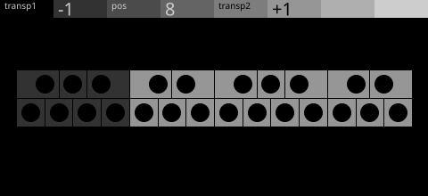

# Epoxy

Machines and extensions build on the Open-XY SDK, for the OP-XY on OS 1.2.1. They are built with the
[Open-XY SDK](https://github.com/etcetc000/open-xy) and reach the [builder](https://open-xy.com)
through its catalog, which pins a tagged commit of this repository.

| Machine | Kind | What it shows |
| --- | --- | --- |
| [Splitter Player](deliverables/splitter/splitter_player) | Player | A player that allows the user to split the OP-XY keyboard into two zones that can be assigned different octave transpositions. Non-destructive, doesn't record, only maps keys to notes. <br><br> |

## Checks

Clone the SDK next to this repository, then from here:

```sh
python ../open-xy/sdk.py test --machine deliverables/splitter/splitter_player
```

## Licences

MIT ([LICENSE](LICENSE)), except vendored code under its own terms, if any.
